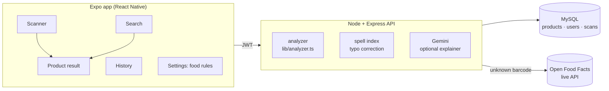

# NutriLens 🍉

NutriLens helps kids with food allergies and dietary restrictions check a snack for themselves. A parent picks the family's food rules once. The child scans a barcode and gets a green, yellow or red answer with one sentence they can understand. Every scan shows up in the family's history, so parents can see what their child is eating.

Built at **Technova 2025** ([Devpost](https://devpost.com/software/nutrilens-jla6p0)) and rebuilt afterwards into a full-stack app.

| | |
|---|---|
| **Catalogue** | the full Open Food Facts export (4.93M rows), **4,582,733 named products** indexed in MySQL |
| **Search** | typo-tolerant search-as-you-type with dietary filters, **p50 5.6 ms · p95 34 ms · 99.7% under 200 ms** over 1,000 generated queries ([benchmark](eval/search-benchmark.json)) |
| **Accuracy** | **97.0%** on 2,000 randomly sampled product–restriction pairs from a held-out seed (95% CI 96.2–97.7%), 97.4% recall on products that contain the restricted item ([report](eval/REPORT.md)) |
| **Rules** | vegan, vegetarian, gluten-, dairy-, egg-, tree-nut-, peanut- and soy-free, low sugar, low salt |

## How it works



- **One analyzer everywhere.** [`lib/analyzer.ts`](lib/analyzer.ts) is pure TypeScript shared by the app, the API, the importer and the evaluation. It matches whole words on normalized text, skips look-alikes (*coconut milk*, *cocoa butter*, *buckwheat*, *nutmeg*), understands negations (*dairy-free*, *sans gluten*), separates "may contain" statements into cautions, reads French on bilingual Canadian labels, and returns **unknown** instead of guessing when a product has no ingredient list.
- **AI explains but never decides.** With `GEMINI_API_KEY` set, Gemini (structured JSON output) adds a kid-friendly explanation and alternatives. It may flag an extra concern, which can only *raise* a warning. Responses are cached in MySQL, and the app works fully without a key.
- **Fast search.** The Open Food Facts dump is streamed into MySQL ([`scripts/import-off.ts`](scripts/import-off.ts)) without unpacking it to disk. A FULLTEXT index serves prefix queries, an in-memory SymSpell index fixes typos (`nutela` → `nutella`), and each product's analyzer result is stored as bitmasks so dietary filters cost one bitwise `AND` per row. Search runs in two tiers: an in-memory table of the ~600K products people actually scan, ranked by popularity, then a best-effort pass over the long tail with a 120 ms budget. That took a common word like *chocolate* from 8.5 s to under 100 ms.
- **Fresh data where it matters.** Barcode scans always check the live Open Food Facts API (3 s timeout) and merge it with the stored copy without ever dropping a warning, because crowd-sourced records change and the export goes stale.
- **Family accounts.** bcrypt-hashed passwords, JWT sessions stored in the device keychain, rate-limited auth, and food rules and scans stored per account so every signed-in device stays in sync.

## Getting started

Requires Node 22+ and MySQL 8+. For the full dataset, give MySQL a 1 GB buffer pool (`SET PERSIST innodb_buffer_pool_size = 1073741824;`) and about 6 GB of disk.

```bash
npm install
```

```bash
cp .env.example .env   # then fill in DATABASE_URL and JWT_SECRET
```

```bash
npm run db:migrate
```

Load product data. The full dump is about 1.5 GB to download, and the import takes 15–20 minutes (pass `--limit 50000` for a quick sample):

```bash
curl -L -o off.csv.gz https://static.openfoodfacts.org/data/en.openfoodfacts.org.products.csv.gz
```

```bash
npm run import:off -- off.csv.gz
```

Run the API and the app in two terminals:

```bash
npm run server
```

```bash
npm start
```

Press `i` for the iOS simulator, `a` for Android or `w` for web. On a physical phone, set `EXPO_PUBLIC_API_URL` in `.env` to your computer's LAN IP. Barcodes not in your local database are fetched live from Open Food Facts, so even a `--limit` import can scan anything.

## Quality

```bash
npm test            # unit + API tests (and MySQL integration tests when TEST_DATABASE_URL is set)
```

```bash
npm run eval -- --n 2000 --seed 42      # accuracy on randomly sampled real products
```

```bash
npm run bench:search -- --queries 1000  # search latency against the running API
```

CI runs typecheck, lint and the tests against a real MySQL on every push ([workflow](.github/workflows/ci.yml)).

## Project layout

```
app/          Expo Router screens (login, home, scanner, search, history, settings, product/[code])
components/   UI components
lib/          shared code: analyzer, restrictions, types, API client, auth context
server/       Express API, MySQL repository, search, spell index, Gemini layer
scripts/      data import, migration, accuracy eval, search benchmark
tests/        Vitest suites
eval/         generated accuracy report and benchmark results
docs/         product brief
```

## Team

Built at Technova 2025 by April Li (lead), Elizabeth Ling, Shinena and Aletha.

Product data © [Open Food Facts](https://world.openfoodfacts.org) contributors, available under the [ODbL](https://opendatacommons.org/licenses/odbl/1-0/).
